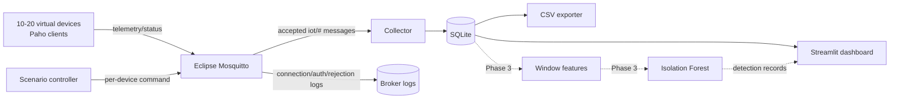

# Architecture

## Context

The MVP is deliberately small: one Docker host, one private Compose network,
one MQTT broker, one simulator process hosting multiple independent MQTT
clients, and one collector. The persisted data contract is designed for the
feature extractor and real-time inference service added in Phase 3.

## Layer mapping

| AIoT layer | Current component | Responsibility |
|---|---|---|
| Device | `src/simulator` | Independent identities, sensor payloads, status, commands, K1-K4 behavior |
| Communication | Mosquitto | MQTT 5 publish/subscribe, authentication, ACL, broker logs |
| Collection | `src/collector` | Subscribe, validate, enrich with receipt metadata, persist, export |
| AI/ML | Planned `src/features` and `src/ml` | 30-second features, Isolation Forest training/inference/evaluation |
| Application | `src/dashboard` | Live device, traffic, scenario, and future detection views |

## Runtime flow

1. Mosquitto generates a password file at container start from environment
   secrets. Anonymous clients are rejected.
2. The collector subscribes to `iot/+/telemetry` and `iot/+/status` as the
   read-only collection role.
3. The simulator creates one Paho network client per device. Every client uses
   its own username, client ID, random generator, sequence, and command topic.
4. A device publishes online status, periodic telemetry, heartbeat status, and
   an offline last will.
5. The collector's MQTT callback copies messages into a bounded queue. A single
   storage worker validates and writes them transactionally to SQLite.
6. The operator publishes a scenario command and waits for the device's status
   acknowledgement. Start/end status messages create scenario event rows and
   determine ground-truth labels on subsequently received telemetry.
7. Streamlit opens short-lived read-only SQLite connections and refreshes the
   visible live fragment. It never writes to the experimental dataset.

## Independence and scaling

Virtual devices share a container only to keep the research MVP operable on a
laptop. They do not share MQTT sessions or client state. `DEVICE_COUNT` controls
the number of clients (10-20 is the intended range). A future ESP32 uses the
same topics and JSON contracts and gets a device-specific broker identity.

## Reliability choices

- Telemetry/status/commands use QoS 1 to make the experiment dataset less
  sensitive to local process timing.
- SQLite uses WAL mode and a single writer thread.
- A bounded ingestion queue applies backpressure by dropping and logging only
  after capacity is exhausted; the queue size is configurable.
- Devices retry initial broker connection and Paho handles later reconnects.
- Each scenario command carries a UUID request ID and each scenario run carries
  a UUID run ID, making acknowledgements and experiment joins explicit.

## Observation boundary

The collector sees only publications the broker accepts and forwards to its
subscriptions. It can measure collector receipt time, topic, forwarded QoS,
retain flag, payload bytes, valid payload fields, and receipt inter-arrival.
It cannot see failed authentication, refused publishes, TCP connection state,
or packets not forwarded to its subscriptions. Mosquitto writes those events to
`mosquitto_logs`; Phase 2 deliberately does not merge logs into the dataset.

## Phase 3 feature contract

Feature windows are event-time windows of 30 seconds per device, using
collector receipt time. Planned fields are `message_count`,
`messages_per_second`, `avg_payload_size`, `std_payload_size`,
`avg_inter_arrival_time`, `std_inter_arrival_time`, and `unique_topic_count`.
Empty windows are retained with counts/rates equal to zero and distribution
statistics null, then imputed by a fitted preprocessing pipeline. A new device
is not scored until it has one complete window. Ground-truth columns and
scenario identifiers are excluded from model inputs.
