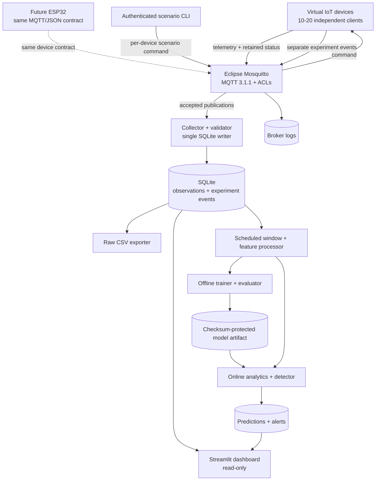
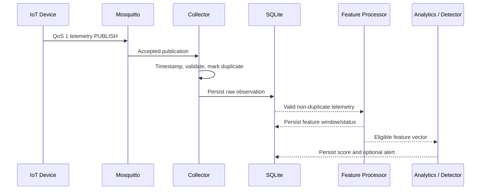

# System Architecture

**Document version:** 1.2

**Updated:** 2026-11-11

**Status:** Implemented MVP architecture; held-out campaign evidence pending

## 1. Architectural principles

1. **Use real MQTT traffic.** Virtual devices connect to an authenticated
   Mosquitto broker with Paho MQTT; CSV replay is not a substitute for the live
   communication path.
2. **Keep device implementations replaceable.** A simulator and a future ESP32
   follow the same versioned MQTT 3.1.1 topics and JSON schemas.
3. **Model communication behavior.** Features use collector receipt time,
   message frequency, inter-arrival gaps, and payload byte size. Sensor values
   and scenario labels are not primary model inputs.
4. **Separate observations from ground truth.** Telemetry is the observable
   input. K1-K4 experiment events and labels travel through a separate topic
   namespace and are joined only for dataset traceability and evaluation.
5. **Reuse one feature implementation.** Offline training and online inference
   must call the same versioned window and feature code.
6. **Separate training from inference.** Models are trained and calibrated
   offline from stored independent runs, then loaded as versioned artifacts by
   the online detector.
7. **Report only measured evidence.** An Isolation Forest score is evidence of
   statistical deviation, not proof of an attack, botnet, or compromise.
8. **Keep the MVP operable on one computer.** The intended fleet is 10-20
   devices, 12 by default, deployed through Docker Compose without a GPU.

## 2. System context and status

Solid paths below are implemented. The dashed ESP32 path remains a replacement
contract rather than a hardware result. Implemented ML source must still not be
described as measured model performance until the held-out campaign completes.



### 2.1. Component status

| Component | Responsibility | Status | Source evidence or gap |
|---|---|---|---|
| Virtual-device fleet | Independent MQTT identities, sessions, sequences, measurements, status, and K1-K4 behavior | Implemented | `src/simulator/`; 12 `iot-NNN` devices connected in the running full stack |
| Mosquitto broker | Authentication, least-privilege ACLs, forwarding, persistence, and broker-only logs | Implemented | `docker/mosquitto/`; six real-broker integration tests passed |
| Scenario CLI | Publish bounded commands and wait for matching acknowledgement/event | Implemented | `src/simulator/controller.py`; short live K1-K4 commands produced ordered start/end events and scenario telemetry |
| Collector | Subscribe, validate, timestamp, deduplicate, label by experiment interval, and persist | Implemented | `src/collector/`; unit/integration tests passed and the live schema-v3 database stored the verified flow |
| SQLite and exports | Store raw evidence plus run-isolated derived tables and reproducible CSV products | Implemented | Raw schema v3 stays unchanged; `src/analytics/storage.py` owns feature, inference-call, prediction, and alert tables; `src/pipeline/exporting.py` owns result exports |
| Streamlit dashboard | Read-only device, traffic, run, prediction, score/threshold, and alert views | Implemented | `src/dashboard/` queries real schema-v3 and derived records and keeps missing-model states explicit |
| Feature processor | Build scheduled 20-second per-device windows every 5 seconds | Implemented | `src/features/windows.py` provides the shared half-open window and seven-feature implementation |
| Trainer and evaluator | Split runs, train/calibrate Isolation Forest, persist artifacts and metrics | Implemented; campaign pending | `src/ml/` and `src/pipeline/` implement fit, threshold calibration, compatibility, export, metrics, events, and figures |
| Online analytics | Load a compatible artifact, score every eligible window, and persist predictions/alerts | Implemented | `src/analytics/` is an experiment-profile Compose service; every scored decision is persisted before the alert subset |
| Campaign runner | Execute isolated train, validation, and test runs in frozen order | Implemented; live campaign pending | `src/experiments/runner.py`, `experiments/run_plan.csv`, and `experiments/split_manifest.json` |

### 2.2. Evidence boundary

The MQTT Phase 2 baseline was previously exercised with real broker traffic:

- 40 host unit tests passed.
- 46 Docker tests passed, including six broker integration tests.
- Docker Compose configuration validation passed.
- Schema-v1-to-v3 and schema-v2-to-v3 migration tests passed, and the live
  database migrated from version 2 to version 3.
- Mosquitto, collector, and dashboard health checks passed while the simulator
  ran all 12 connected clients.
- The live database contained all 12 default `iot-NNN` devices.
- Retained status arrived with `retain = 1`; a forced disconnect also exercised
  the retained Last Will path.
- Short K1-K4 runs persisted ordered start/end events and associated telemetry;
  K2 produced 20 messages with burst-scale inter-arrival gaps.

The feature, artifact, analytics, campaign, export, and evaluation contracts now
have deterministic automated tests. Those tests establish implementation
behavior, not held-out accuracy. Chapter IV classification, latency, resource,
and event-detection values exist only after the frozen live campaign creates
them under `results/`.

## 3. Layered architecture

| Layer | Current or target component | Responsibility |
|---|---|---|
| Device | `src/simulator`, future ESP32 | Produce measurements, maintain one MQTT session per identity, publish status, and apply bounded scenario commands |
| Communication | Mosquitto | Authenticate clients, enforce topic ownership, forward accepted MQTT 3.1.1 publications, and keep broker logs |
| Collection | `src/collector` | Record collector receipt metadata, validate topic/payload identity, mark duplicates, and persist raw evidence |
| Processing | `src/features`, `src/analytics` | Build deterministic scheduled windows and versioned communication features |
| AI | `src/ml`, `src/pipeline` | Fit, calibrate, version, load, score, and evaluate Isolation Forest artifacts |
| Storage | SQLite, CSV, model files | Persist raw observations, experiment metadata, feature windows, model metadata, scores, and alerts |
| Application | `src/dashboard` | Present traceable device, traffic, scenario, model, and alert information without collecting MQTT itself |

## 4. MQTT namespaces and trust boundary

The canonical application topics are:

| Topic | Publisher | Subscriber | Retain |
|---|---|---|---|
| `iot/v1/devices/{device_id}/telemetry` | Device | Collector | `false` |
| `iot/v1/devices/{device_id}/status` | Device or Last Will | Collector | `true` |
| `iot/v1/devices/{device_id}/command` | Operator role | Target device | `false` |
| `experiments/v1/devices/{device_id}/events` | Target device | Collector and operator | `false` |

Telemetry, status, commands, and experiment events use QoS 1. Device identity is
not established by a JSON field or Client ID alone; it is established by broker
authentication plus ACL ownership and then checked against the topic and
payload contract.

The collector sees only publications accepted and forwarded by the broker. It
can observe the topic, forwarded QoS, retain and duplicate flags, payload bytes,
collector receipt time, and validated application fields. It cannot observe
failed authentication, refused publications, unforwarded packets, or the full
broker session table. Those events remain in Mosquitto logs and are not silently
merged into the ML dataset.

## 5. Module responsibilities and interfaces

### 5.1. Device simulator

- Creates one independently stateful Paho client per Device ID.
- Uses MQTT 3.1.1, a new UUID `session_id` at process start, and a monotonically
  increasing `sequence_no` within that session.
- Publishes a normal telemetry profile approximately every 5 seconds with
  bounded per-device jitter.
- Publishes retained `online` status only after successful command-topic SUBACK
  and configures a retained `offline` Last Will. A clean shutdown publishes
  `offline` before disconnect.
- Subscribes only to its own command topic.
- Runs K1-K4 for an explicit duration and seed, with hard rate and payload-size
  bounds suitable for a laptop lab.
- Publishes scenario start/end ground truth to the experiment-event topic, not
  inside telemetry.

### 5.2. MQTT broker

- Runs Eclipse Mosquitto on the private Compose network.
- Disables anonymous access and creates credentials from environment-provided
  secrets.
- Allows a device to publish telemetry, status, and experiment events only for
  its own Device ID and to read only its own command topic.
- Allows the collector to read telemetry, status, and experiment events but not
  publish device data.
- Allows the operator to publish commands and read the corresponding experiment
  acknowledgement events.
- Binds the host listener to `127.0.0.1` by default; container traffic remains
  on the private Compose network.

### 5.3. Collector

- Subscribes to `iot/v1/devices/+/telemetry`,
  `iot/v1/devices/+/status`, and
  `experiments/v1/devices/+/events`.
- Captures `received_at_utc` in the MQTT callback before queued persistence and
  keeps `sent_at_utc` as separate diagnostic metadata.
- Copies messages into a bounded queue so SQLite writes do not block the Paho
  network loop. An atomic sidecar records queue depth, enqueue/persist
  watermarks, and bounded `queue_full` or `storage_error` loss events.
- Validates UTF-8 JSON, schema version, topic shape, Device ID equality, RFC
  3339 UTC timestamps, session ID, sequence number, and configured payload-size
  limits.
- Retains auditable invalid/duplicate telemetry metadata so the current
  dashboard and feature processor can exclude it. Invalid
  experiment events are currently logged rather than persisted diagnostically.
- Marks a QoS 1 redelivery by `(device_id, session_id, sequence_no)`.
- Uses one SQLite writer, WAL mode, busy timeout, reconnect handling, and clean
  shutdown.
- Does not infer broker-only events that it cannot observe.

### 5.4. Feature processor

- Uses valid, non-duplicate telemetry ordered by collector receipt time.
- Builds per-device half-open windows `[start, end)` with a default duration of
  20 seconds and stride of 5 seconds.
- Requires at least three messages. Smaller windows are stored as
  `insufficient_data` and are not sent to the model.
- Implements the exact ordered feature schema and formulas in `DATA_DESIGN.md`,
  including population standard deviations and one-second peak message rate.
- Produces the same feature representation for offline training and online
  inference.
- Keeps Device ID, experiment ID, scenario, label, and raw timestamps as
  metadata, never model inputs.

### 5.5. ML trainer and evaluator

1. Select independent normal experiment runs for training.
2. Split training, validation, and test by campaign run ID before assigning any
   overlapping windows across splits.
3. Fit Isolation Forest on usable normal training windows with random seed 42.
4. Select and freeze the first-percentile `decision_function` threshold on
   normal validation data, never the final test set.
5. Store the model, SHA-256, feature schema and order, window settings,
   threshold, seed, run IDs, split manifest, and dependency versions as one
   controlled artifact set.
6. Evaluate held-out K1-K4 runs and persist the confusion matrix, Precision,
   Recall, F1, FPR, detection latency, insufficient-data count, and missed runs.

Public datasets may be studied as separate offline experiments only when their
features and labels are explicitly mapped. They must not be presented as proof
that the live MQTT pipeline works.

### 5.6. Online analytics and detector

- Loads a model artifact only when its feature schema and window configuration
  match the running processor.
- Scores each eligible completed window using a documented score direction and
  frozen threshold.
- Persists every valid normal/anomaly decision in `window_predictions`, records
  one timing row per inference batch, and creates one traceable alert for every
  decision below the frozen threshold. No alert cooldown is applied in the
  campaign because evaluation uses all decisions.
- Continues feature collection when no model directory is configured; the ready
  record reports `model_loaded=false` and no score or alert is fabricated.
- Rejects a missing, checksum-invalid, or schema-incompatible configured
  artifact rather than starting inference with ambiguous state.

### 5.7. Dashboard

- Opens short-lived read-only SQLite connections and never acts as a second MQTT
  collector or experimental-data writer.
- Distinguishes retained online/offline state from stale state. Live freshness
  uses collector receipt time; retained replay state is bounded to the earlier
  of its publisher timestamp and collector receipt time.
- Displays fleet counts, throughput, payload and inter-arrival behavior, raw
  validation state, and K1-K4 history from real stored observations.
- Displays model readiness, scores, alerts, and model version only when real ML
  tables and compatible data exist.
- Does not provide credentials or controls for attacks outside the lab. Scenario
  activation remains in the authenticated operator CLI.

## 6. Runtime flows

### 6.1. Startup and device lifecycle

1. Mosquitto generates its runtime password and ACL files from environment
   secrets and starts with anonymous access disabled.
2. The collector connects and subscribes to the three allowed wildcard topic
   branches.
3. The simulator starts one client and one session UUID per configured device.
4. Each device registers its retained offline Last Will, connects, subscribes to
   its command topic, waits for SUBACK, and publishes retained online status.
5. The dashboard waits for a readable SQLite schema and then serves read-only
   views.

### 6.2. Telemetry collection



The raw record remains the reproducible source. Analytics derives scheduled
feature rows, inference-call timing, every prediction, and the alert subset in
the same run-isolated database without changing raw schema version 3.

### 6.3. Scenario and ground-truth flow

1. The operator CLI creates a request ID and sends a bounded `set_scenario`
   command to one target device.
2. The device starts K1-K4 using the requested duration and seed, creates an
   `experiment_run_id`, and publishes `scenario_started` on the separate event
   topic.
3. The collector persists the event and associates subsequently received target
   telemetry with the active experiment interval for traceability only. Active
   duration uses collector receipt time, not the potentially skewed device clock.
4. At expiry or replacement, the device publishes `scenario_ended`; normal
   communication resumes.
5. Evaluation joins labels after feature generation. Scenario and label fields
   never enter `model.fit()`, `score_samples()`, or inference vectors.

If a run has no valid end event because of a crash, recovery must close or mark
the run incomplete from its configured duration; it must not leave an abnormal
label active indefinitely.

### 6.4. Training and inference flow

1. The frozen plan records two independent normal training runs and one normal
   validation run before any held-out test run.
2. Analytics writes scheduled feature rows using the same implementation later
   used for test inference.
3. The host trainer fits normal training rows and freezes the threshold from
   validation rows.
4. The trainer saves a checksum-protected artifact and manifest under
   `results/artifacts/`.
5. Each test-run analytics process loads that frozen artifact and persists every
   eligible decision.
6. The exporter/evaluator constructs the complete scheduled grid, left-joins
   quality, truth, and prediction records, and writes reproducible held-out
   metrics and figures.

## 7. Docker deployment

### 7.1. Current runtime services

| Service | Role | Lifecycle |
|---|---|---|
| `mosquitto` | Authenticated MQTT broker and broker logs | Long-running |
| `simulator` | Fleet of independent virtual MQTT clients | Long-running |
| `collector` | MQTT subscriber, validator, and current SQLite writer | Long-running |
| `analytics` | Scheduled feature processor and optional online detector | One process per campaign run through the `experiment` profile |
| `dashboard` | Read-only Streamlit interface | Long-running |
| `scenario` | Authenticated K1-K4 command CLI | On demand through the `tools` profile |
| `tests` | Unit and real-broker integration tests | On demand through the `test` profile |

The interactive lab keeps its database under the bind-mounted `data/runtime/`
directory for local inspection. Chapter IV runs use a different topology: the
live WAL database is stored in the Docker-managed `experiment_data` named
volume at `/app/experiment-data/run.db`, shared only by Collector and Analytics
inside the Linux VM. The host never opens the live campaign database. After
Analytics exits successfully, the runner stops every SQLite writer, performs a
container-side checkpoint and integrity check, and copies the verified database
and state sidecar into the per-run `results/` directory. There is no separate
database server container.

### 7.2. Training and evaluation deployment

Training, per-run export, and evaluation are host-side on-demand Python CLIs.
The campaign runner calls the trainer after train/validation collection and
before the first test. The analytics container then loads the frozen artifact
for test runs. SQLite remains appropriate for this bounded research MVP;
Redis, Kafka, Kubernetes, and a distributed database are not required.

## 8. Reliability and data-quality decisions

- QoS 1 improves local experiment delivery but permits redelivery; deduplication
  is mandatory before feature counting.
- Collector receipt time is the authoritative time basis for frequency and
  inter-arrival features because device clocks may drift.
- A bounded ingestion queue protects the MQTT callback. Any dropped observation
  is an explicit operational error and marks intersecting windows
  `observation_gap`, not an invisible normal sample.
- Analytics consults the collector watermark before closing a due window, so a
  deliberately slow SQLite worker cannot cause premature feature/prediction
  persistence for a message already received before the boundary.
- SQLite uses WAL and a busy timeout; collector raw writes and analytics derived
  writes use separate serialized connections. During a campaign, live readers
  also remain inside the Linux container environment. Host-side training,
  export, evaluation, and dashboard inspection begin only after writer shutdown
  and a successful checkpoint/integrity gate.
- The runner monitors Analytics liveness, captures experiment-profile logs, and
  prevents a corrupt, incomplete, or interrupted database from entering model
  training or evaluation.
- Invalid JSON, invalid identity, oversized payload, unsupported schema, and
  unknown topics are logged and excluded from model input.
- Empty or undersized windows are not zero-filled to force inference.
- Missing observations are represented as a data gap; the system does not
  assume an unobserved publication occurred.
- Scenario traffic and diagnostic payloads have hard bounds to avoid accidental
  denial of service.

## 9. Security boundary

- Runtime credentials come from environment variables or secret files and are
  never embedded in source, raw MQTT rows, CSV exports, or model artifacts.
- Anonymous access is disabled. Device, collector, and operator roles receive
  only the MQTT permissions required by their responsibilities.
- Host MQTT and dashboard ports bind to localhost by default.
- The lab uses an isolated Docker network. TLS and unique production credential
  provisioning must be reassessed before any LAN or public deployment.
- A payload Device ID is not trusted until it matches the authenticated topic
  identity and schema.
- Dashboard users cannot publish MQTT commands through the read-only database
  connection.

## 10. Source ownership map

```text
src/
  common/       # environment settings, MQTT topics/contracts, logging
  simulator/    # virtual devices, K1-K4 behavior, authenticated operator CLI
  collector/    # MQTT callback, validation, SQLite persistence, raw export
  features/     # scheduled windowing and seven-feature schema
  ml/           # Isolation Forest artifact, inference, and metric contracts
  analytics/    # online features, predictions, timing, and alerts
  experiments/  # frozen plan, result manifests, functional evidence, runner
  pipeline/     # training, export, evaluation, and figures
  dashboard/    # Streamlit UI and read-only query layer
docker/
  mosquitto/    # broker image, ACL/password generation, Mosquitto configuration
scripts/        # bootstrap, campaign, training, export, and evaluation CLIs
tests/          # unit and real-broker integration verification
data/           # ignored interactive runtime and raw exports
experiments/    # committed canonical run plan and split manifest
results/        # ignored generated evidence and frozen model artifacts
```

## 11. Architecture validation gates

### 11.1. Phase 2 core runtime — passed with one diagnostic gap

The Phase 2 gate is complete. Simulator, controller, collector, ACLs, tests, and
documentation use MQTT 3.1.1 and the same versioned topic branches. Contract and
broker integration tests passed; schema-v3 persistence preserves session and
sequence identity, byte size, duplicate state, receipt time, and experiment
traceability; and the healthy Compose stack recorded all 12 default devices.
Invalid experiment events are rejected and logged rather than persisted as raw
diagnostic rows, so the broader protocol contract remains Partial.

### 11.2. ML implementation gate — passed by source and deterministic tests

The implementation gate requires and now has:

1. `DATA_DESIGN.md` feature formulas and half-open window boundaries have unit
   tests.
2. Training and inference import the same feature implementation.
3. Run-level split manifests prove that overlapping windows cannot cross data
   splits.
4. A registered artifact contains enough metadata for compatibility checks and
   reproduction.
5. The dashboard reads only persisted real scores and alerts.

### 11.3. Held-out campaign gate — pending measured evidence

The Chapter IV gate passes only after all planned runs complete in the frozen
order, the artifact is created before test collection, scenario behavior is
verified from observations, exports retain missing rows and coverage reasons,
and metrics/figures are regenerated from `results/`. Source completion alone
does not pass this gate.

## 12. References

- OASIS MQTT 3.1.1: <https://docs.oasis-open.org/mqtt/mqtt/v3.1.1/os/mqtt-v3.1.1-os.html>
- Eclipse Paho Python client: <https://eclipse.dev/paho/clients/python/>
- Eclipse Mosquitto authentication: <https://mosquitto.org/documentation/authentication-methods/>
