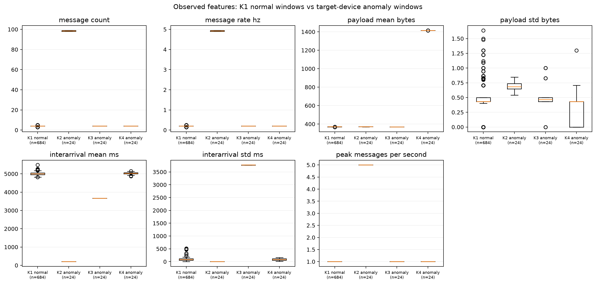
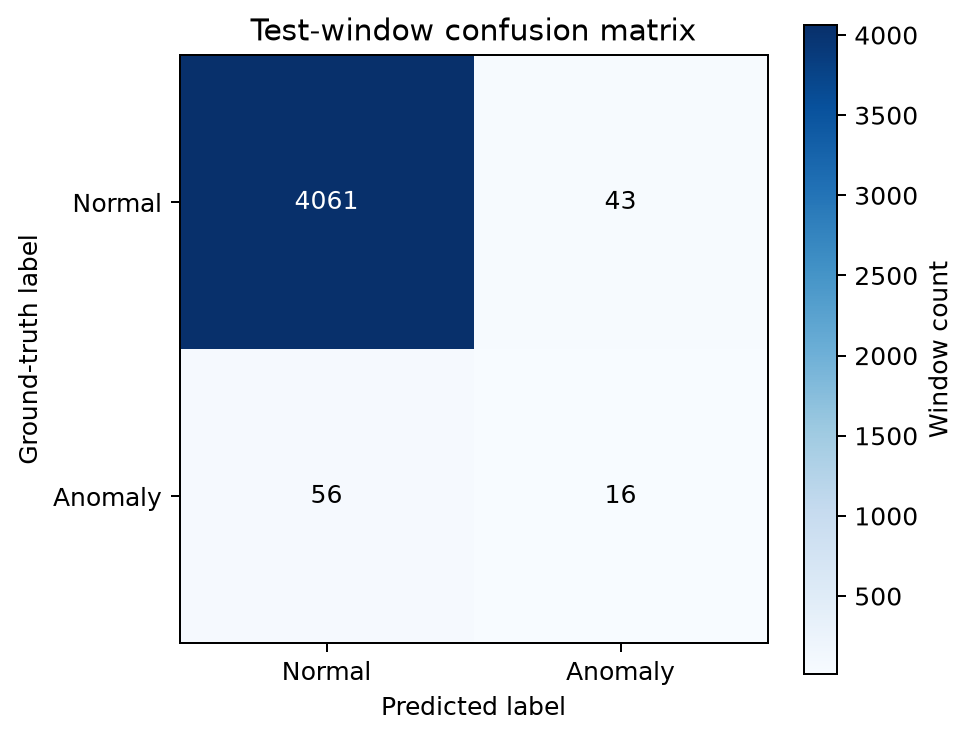
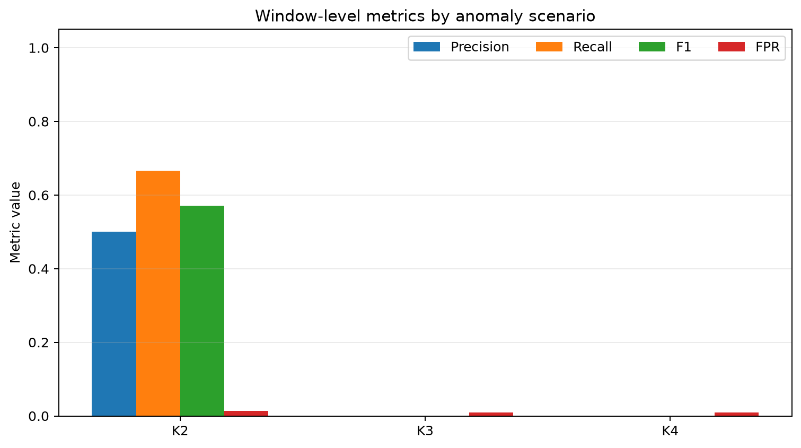
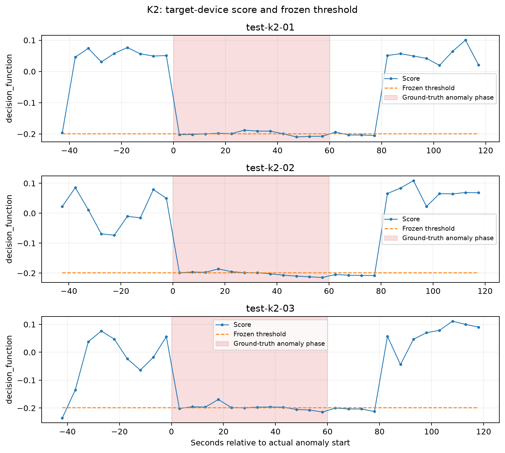
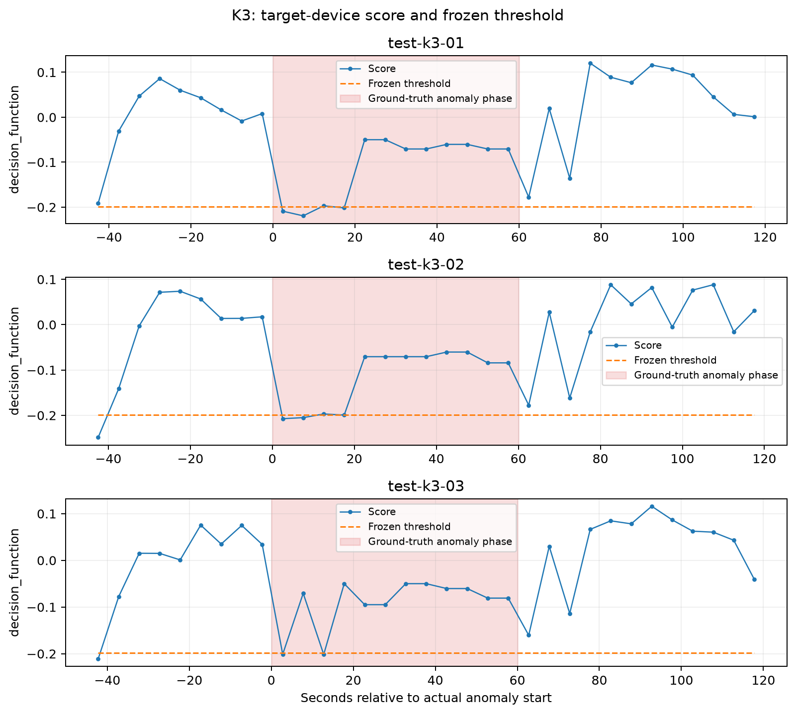
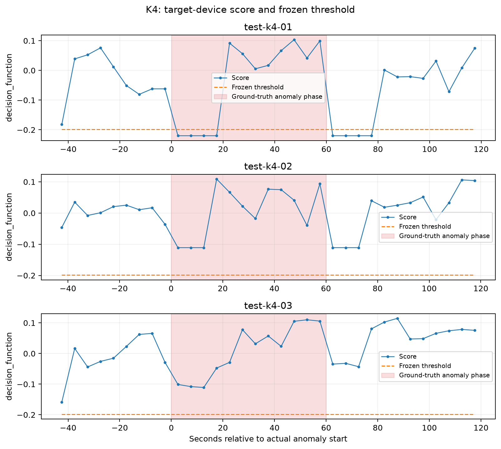

# CHƯƠNG IV. KẾT QUẢ

Chương này trình bày kết quả triển khai, mô phỏng và đánh giá hệ thống phát
hiện hành vi bất thường trên thiết bị IoT. Toàn bộ số liệu được tổng hợp từ
chiến dịch thực nghiệm ngày 11/11/2026 và các tệp bằng chứng trong thư mục
`results/`. Chiến dịch gồm 13 lượt chạy độc lập, 12 thiết bị mô phỏng trao đổi
dữ liệu qua MQTT thật trong môi trường lab, hai lượt thu dữ liệu huấn luyện, một
lượt hiệu chỉnh ngưỡng và mười lượt kiểm thử.

Các kịch bản K2–K4 và nhãn pha do bộ điều khiển mô phỏng tạo ra chỉ được dùng
làm **nhãn đối chiếu thực nghiệm**. Chúng không phải là đầu ra của mô hình và
không xuất hiện trong bảy đặc trưng đưa vào Isolation Forest. Các kết luận về
khả năng phát hiện trong chương này chỉ dựa trên `score`, ngưỡng và nhãn dự
đoán đã được pipeline phân tích lưu lại.

## 4.1. Kết quả xây dựng hệ thống

### 4.1.1. Môi trường và cấu hình thực nghiệm

Hệ thống được triển khai trên một máy lab, sử dụng Docker Desktop để cô lập
Broker, Simulator, Collector, Analytics và Dashboard. Bảng 4.1 ghi lại đúng
môi trường đã dùng trong chiến dịch từ `results/environment.json`.

**Bảng 4.1. Môi trường thực nghiệm**

| Thành phần | Giá trị đã đo |
|---|---|
| Máy chủ | Apple arm64, macOS 26.3.1, 8 CPU logic, RAM vật lý 16 GiB |
| Docker | Docker Desktop 29.6.1, kiến trúc aarch64 |
| Tài nguyên Docker | 8 CPU logic, 8.321.798.144 byte RAM |
| Docker Compose | v5.3.0 |
| Python / SQLite | CPython 3.14.6 / SQLite 3.54.1 |
| Mosquitto / Paho MQTT | 2.1.2 / 2.1.0 |
| scikit-learn / joblib | 1.9.1 / 1.6.0 |
| NumPy / SciPy / pandas | 2.5.4 / 1.18.1 / 3.1.1 |
| Streamlit / Matplotlib | 1.67.0 / 3.11.2 |
| Docker image ứng dụng | `sha256:0913f33498c2334b00fe96d5452f1f95ab8cad5ae102d3d5de0f6f08fedbb70f` |
| Commit ghi nhận môi trường | `6fa99709dca11a37e72508eec4bd911b9faeeb1b` |
| Commit kiểm thử/hậu xử lý cuối | `25604a250373ef0a1d23f1bdfe530d9eecb181b1` |

**Bảng 4.2. Cấu hình thực nghiệm đã khóa**

| Tham số | Giá trị |
|---|---|
| Số thiết bị | 12, từ `iot-001` đến `iot-012` |
| Giao thức | MQTT 3.1.1; telemetry QoS 1, không retained |
| Nhịp nền | 5 giây/bản tin, jitter đều trong ±0,5 giây |
| Pha gửi ban đầu | Phân tán trong 0–5 giây |
| Cửa sổ đặc trưng | 20 giây, bước trượt 5 giây, biên `[start,end)` |
| Điều kiện tối thiểu | 3 telemetry hợp lệ/cửa sổ |
| K2 | 5 bản tin/giây trong 60 giây |
| K3 | Xen kẽ khoảng gửi 1 giây và 9 giây trong 60 giây |
| K4 | Thêm chuỗi chẩn đoán ASCII 1.024 byte trong 60 giây |
| Cấu trúc lượt bất thường | 60 giây nền + 60 giây bất thường + 60 giây phục hồi |
| Seed mô hình | `random_state=42` |

Kế hoạch đầy đủ được lưu trong `results/run_plan.csv`. Bốn lượt K1 đầu tiên
được thu bằng commit `25e22c8e`; chín lượt K2–K4 dùng commit `6fa99709`, trong
đó bản sửa chỉ xử lý độ trễ watermark ở mốc kết thúc pha. Bảy công thức đặc
trưng và artifact mô hình không thay đổi giữa hai revision. Đây vẫn là hạn chế
về provenance vì chiến dịch không chạy hoàn toàn trên một commit duy nhất.

### 4.1.2. Kết quả triển khai các thành phần

Pipeline hoàn chỉnh đã hoạt động theo chuỗi Simulator → Mosquitto → Collector →
SQLite → Analytics/Isolation Forest → Dashboard.

**Bảng 4.3. Trạng thái các thành phần hệ thống**

| Thành phần | Kết quả triển khai | Bằng chứng chính |
|---|---|---|
| Mosquitto Broker | Xác thực và ACL riêng cho thiết bị/Collector; nhận QoS 1 | T04 và log Broker |
| Simulator | 12 client độc lập; tạo K1–K4 và mốc pha | `scenario_phases.csv`, `messages.csv` |
| Collector | Kiểm tra schema/topic/identity, chống trùng, ghi SQLite | T02, T03, T05, `run.db` |
| Feature processor | Tạo lịch cửa sổ 20/5 giây và đúng bảy đặc trưng | T07–T10, `feature_windows.csv` |
| Trainer | Huấn luyện từ hai run nền, hiệu chỉnh bằng validation | `results/artifacts/` |
| Analytics | Chấm điểm mọi cửa sổ test và lưu prediction/alert | `predictions.csv`, `alerts.csv` |
| Dashboard | Đọc SQLite chỉ đọc; hiển thị thiết bị, score và alert thật | T14; dữ liệu mục 4.4 |
| Export/Evaluator | Xuất coverage, ma trận, chỉ số, sự kiện và hình | CSV/JSON và `results/figures/` |

Toàn bộ 13 database được chấp nhận đều trả về `quick_check=ok` và
`integrity_check=ok`. Sidecar cuối mỗi run ghi `queue_depth=0`,
`dropped_message_count=0` và `accepting_messages=false`. Hai lần thử lỗi vẫn
được giữ riêng để truy vết: attempt đầu của `train-normal-01` bị lỗi cấu trúc
SQLite; attempt đầu của `test-k2-01` dừng do mốc kết thúc pha đi trước safe
watermark. Hai lần chạy lại thành công dùng collection session mới và dữ liệu
lỗi không được đưa vào huấn luyện hoặc đánh giá.

### 4.1.3. Kết quả kiểm thử chức năng

Ma trận T01–T16 được chạy lại lúc `2026-11-11T13:28:26.574410Z` (UTC) trên commit
`25604a250373ef0a1d23f1bdfe530d9eecb181b1`. Kết quả là **16 pass, 0 fail,
0 not_run**. Các mục liên quan MQTT sử dụng Broker thật trong môi trường cô lập.

**Bảng 4.4. Kết quả kiểm thử chức năng T01–T16**

| Mã | Nội dung | Kết quả | Minh chứng tóm tắt |
|---|---|---|---|
| T01 | Khởi động môi trường | Pass | 13/13 run và integrity gate đạt; log không lộ credential |
| T02 | Kết nối đủ 12 thiết bị | Pass | Có telemetry chuẩn từ đủ `iot-001`–`iot-012` |
| T03 | Schema, topic, identity và kích thước | Pass | 4 kiểm thử tự động đạt |
| T04 | Xác thực và ACL | Pass | Sai mật khẩu bị từ chối; publish trái quyền không được chuyển tiếp |
| T05 | QoS 1 và chống trùng | Pass | 3 kiểm thử khóa ứng dụng đạt |
| T06 | Status và retained | Pass | 3 kiểm thử, gồm MQTT retained thật, đạt |
| T07 | Biên cửa sổ và tính đặc trưng | Pass | 2 kiểm thử `[start,end)`, byte, độ lệch chuẩn và bucket đạt |
| T08 | Cửa sổ thiếu dữ liệu | Pass | Không tạo điểm hoặc nhãn giả |
| T09 | Đóng cửa sổ bất đồng bộ | Pass | 2 kiểm thử pending/loss; 13 run có hàng đợi cuối bằng 0 |
| T10 | Đồng nhất online/offline | Pass | Replay 396/396 vector và prediction, 0 sai khác ở `1e-9` |
| T11 | Nạp mô hình và ngưỡng | Pass | 3 kiểm thử checksum/schema/quy tắc ngưỡng đạt |
| T12 | Lưu dự đoán và chống trùng | Pass | 2 kiểm thử persistence/idempotency đạt |
| T13 | Tách phiên và tách run | Pass | 2 kiểm thử retry/archive/session isolation đạt |
| T14 | SQLite và giao diện | Pass | 2 kiểm thử dashboard chỉ đọc và dữ liệu thật đạt |
| T15 | Kịch bản và nhãn đối chiếu | Pass | 3 kiểm thử mốc pha/unknown/chống rò nhãn đạt |
| T16 | Mất kết nối, last-seen và phục hồi | Pass | 3 kiểm thử Last Will/reconnect đạt |

Chi tiết nằm trong `results/functional_tests.csv`, bằng chứng live ở
`results/evidence/live-functional.json` và replay T10 ở
`results/evidence/t10-replay-test-k2-01.json`.

## 4.2. Kết quả mô phỏng và thu thập dữ liệu

### 4.2.1. Kịch bản K1: Hoạt động bình thường

K1 vừa tạo nền học mô hình vừa đo cảnh báo sai trên test độc lập. Hai run train
tạo 725 và 728 telemetry hợp lệ, mỗi run có 684 cửa sổ. Run validation tạo 724
telemetry và 684 cửa sổ. `test-normal-01` tạo 724 telemetry, 684 cửa sổ và toàn
bộ đều được chấm điểm.

Trên K1 test, trung vị số bản tin là 4, tốc độ 0,2 bản tin/giây, payload trung
bình 370,5 byte, khoảng cách trung bình 5.004,0 ms và đỉnh tải 1 bản tin/giây.
Mô hình phát sinh 6 cảnh báo sai/684 cửa sổ, FPR 0,877%. K1 không có mẫu bất
thường nên Recall và F1 không áp dụng.

### 4.2.2. Kịch bản K2: Tăng đột biến tần suất gửi

Ba run K2 nhắm lần lượt `iot-001`, `iot-002`, `iot-003`, thu tổng cộng 2.165
telemetry hợp lệ. Mỗi run tạo 396 cửa sổ: 388 cửa sổ normal/anomaly đủ điều kiện
cho ma trận và 8 transition được giữ lại nhưng loại khỏi chỉ số chính.

Trên 24 cửa sổ nằm hoàn toàn trong pha K2, trung vị số bản tin tăng từ 4 lên
98,5, tốc độ từ 0,2 lên 4,925 bản tin/giây, khoảng cách trung bình giảm từ
5.004,0 ms xuống 202,90 ms và đỉnh tải tăng từ 1 lên 5 bản tin/giây. Dữ liệu
xác nhận K2 thực sự xuất hiện trong luồng Collector quan sát.

| Run K2 | Telemetry | Cửa sổ | Alert | TP | FP | TN | FN | F1 |
|---|---:|---:|---:|---:|---:|---:|---:|---:|
| `test-k2-01` | 721 | 396 | 15 | 5 | 4 | 376 | 3 | 0,5882 |
| `test-k2-02` | 721 | 396 | 17 | 7 | 5 | 375 | 1 | 0,7000 |
| `test-k2-03` | 723 | 396 | 16 | 4 | 7 | 373 | 4 | 0,4211 |
| **Gộp K2** | **2.165** | **1.188** | **48** | **16** | **16** | **1.124** | **8** | **0,5714** |

### 4.2.3. Kịch bản K3: Chu kỳ gửi không đều

Ba run K3 thu 1.311 telemetry hợp lệ và đủ 1.188 cửa sổ. Ở 24 cửa sổ anomaly
K3, trung vị số bản tin vẫn là 4 và tốc độ vẫn là 0,2 bản tin/giây; khoảng cách
trung bình là 3.668,87 ms, còn độ lệch chuẩn khoảng cách tăng từ 83,41 ms ở K1
lên 3.771,48 ms. Mô phỏng đã tạo đúng tính “không đều”, nhưng tổng số bản tin
trong cửa sổ 20 giây hầu như không đổi.

| Run K3 | Telemetry | Cửa sổ | Alert | TP | FP | TN | FN | F1 |
|---|---:|---:|---:|---:|---:|---:|---:|---:|
| `test-k3-01` | 436 | 396 | 6 | 0 | 3 | 377 | 8 | 0,0000 |
| `test-k3-02` | 436 | 396 | 8 | 0 | 5 | 375 | 8 | 0,0000 |
| `test-k3-03` | 439 | 396 | 5 | 0 | 3 | 377 | 8 | 0,0000 |
| **Gộp K3** | **1.311** | **1.188** | **19** | **0** | **11** | **1.129** | **24** | **0,0000** |

### 4.2.4. Kịch bản K4: Thay đổi kích thước bản tin

Ba run K4 thu 1.315 telemetry hợp lệ và 1.188 cửa sổ. Trung vị payload của 24
cửa sổ anomaly tăng từ 370,5 byte ở K1 lên 1.415,0 byte, trong khi số bản tin
vẫn là 4 và tốc độ 0,2 bản tin/giây. Dữ liệu xác nhận chuỗi chẩn đoán 1.024 byte
đã đi qua MQTT và được Collector đo trong payload gốc.

| Run K4 | Telemetry | Cửa sổ | Alert | TP | FP | TN | FN | F1 |
|---|---:|---:|---:|---:|---:|---:|---:|---:|
| `test-k4-01` | 439 | 396 | 11 | 0 | 3 | 377 | 8 | 0,0000 |
| `test-k4-02` | 441 | 396 | 4 | 0 | 4 | 376 | 8 | 0,0000 |
| `test-k4-03` | 435 | 396 | 3 | 0 | 3 | 377 | 8 | 0,0000 |
| **Gộp K4** | **1.315** | **1.188** | **18** | **0** | **10** | **1.130** | **24** | **0,0000** |

Hình 4.1 so sánh bảy đặc trưng của 684 cửa sổ K1 test với 24 cửa sổ anomaly
nằm hoàn toàn trong pha của từng K2, K3, K4; control và transition không bị trộn
vào nhóm anomaly.

### 4.2.5. Thống kê bộ dữ liệu thực nghiệm

Chiến dịch hoàn thành đủ 13/13 run với 2.820 giây theo kế hoạch. Tổng thời gian
thực tế giữa mốc đầu–cuối của các run là 2.857,063 giây do có điều phối và chờ
đóng pipeline.

**Bảng 4.5. Toàn bộ run và sản phẩm dữ liệu**

| Run | Vai trò/kịch bản | Attempt | Telemetry | Cửa sổ | Prediction | Alert |
|---|---|---:|---:|---:|---:|---:|
| `train-normal-01` | Train/K1 | 2 | 725 | 684 | 0 | 0 |
| `train-normal-02` | Train/K1 | 1 | 728 | 684 | 0 | 0 |
| `validation-normal-01` | Validation/K1 | 1 | 724 | 684 | 0 | 0 |
| `test-normal-01` | Test/K1 | 1 | 724 | 684 | 684 | 6 |
| `test-k2-01` | Test/K2 | 2 | 721 | 396 | 396 | 15 |
| `test-k2-02` | Test/K2 | 1 | 721 | 396 | 396 | 17 |
| `test-k2-03` | Test/K2 | 1 | 723 | 396 | 396 | 16 |
| `test-k3-01` | Test/K3 | 1 | 436 | 396 | 396 | 6 |
| `test-k3-02` | Test/K3 | 1 | 436 | 396 | 396 | 8 |
| `test-k3-03` | Test/K3 | 1 | 439 | 396 | 396 | 5 |
| `test-k4-01` | Test/K4 | 1 | 439 | 396 | 396 | 11 |
| `test-k4-02` | Test/K4 | 1 | 441 | 396 | 396 | 4 |
| `test-k4-03` | Test/K4 | 1 | 435 | 396 | 396 | 3 |

**Bảng 4.6. Chất lượng và độ bao phủ dữ liệu**

| Phạm vi | Bản ghi nhận | Telemetry hợp lệ | Status/khác | Cửa sổ lịch | Đặc trưng hợp lệ |
|---|---:|---:|---:|---:|---:|
| Train K1 | 1.717 | 1.453 | 264 | 1.368 | 1.368 |
| Validation K1 | 855 | 724 | 131 | 684 | 684 |
| Test K1 | 856 | 724 | 132 | 684 | 684 |
| Test K2 | 2.417 | 2.165 | 252 | 1.188 | 1.188 |
| Test K3 | 1.563 | 1.311 | 252 | 1.188 | 1.188 |
| Test K4 | 1.567 | 1.315 | 252 | 1.188 | 1.188 |
| **Tổng** | **8.975** | **7.692** | **1.283** | **6.300** | **6.300** |

Không có bản tin trùng, invalid, cửa sổ mất quan sát, thiếu telemetry hoặc đặc
trưng lỗi trong 13 run được chấp nhận. Cả 4.248 cửa sổ test đều được chấm điểm,
nên `C_score=100%`. Có 72 transition (24 cho mỗi K2/K3/K4) được giữ để truy
vết nhưng loại khỏi ma trận; `C_eval=4.176/4.248=98,305%`.

## 4.3. Kết quả huấn luyện và đánh giá mô hình

### 4.3.1. Cấu hình mô hình và ngưỡng phát hiện

Artifact `iforest-ch4-v1` được fit trên 1.368 cửa sổ normal của hai run train.
Ngưỡng được hiệu chỉnh độc lập trên 684 cửa sổ normal validation. Phân vị 1%
của `decision_function` tạo ngưỡng `-0,19866024964185736`. Pipeline chỉ gán
anomaly khi `score < threshold`.

**Bảng 4.7. Cấu hình Isolation Forest đã khóa**

| Tham số | Giá trị |
|---|---|
| Số cây | 100 |
| `max_samples` / `max_features` | `auto` / 1,0 |
| `contamination` / `bootstrap` | `auto` / `false` |
| `random_state` | 42 |
| Cửa sổ train / validation | 1.368 / 684 |
| Phân vị / ngưỡng | 0,01 / `-0,19866024964185736` |
| Schema | phiên bản 1.0, đúng 7 đặc trưng |
| SHA-256 model | `c5b1adb0ad79cb4385ae11883222aa05f10d029e60d257219285503070fb1348` |
| Thời gian fit / fit và lưu artifact | 2,278 / 2,295 giây |

Bảy đặc trưng theo thứ tự là `message_count`, `message_rate_hz`,
`payload_mean_bytes`, `payload_std_bytes`, `interarrival_mean_ms`,
`interarrival_std_ms`, `peak_messages_per_second`. Phép reload artifact kiểm tra
lại 32 dòng cho kết quả nhất quán.

### 4.3.2. Ma trận nhầm lẫn và các chỉ số đánh giá

Ma trận gộp trên 4.176 cửa sổ đủ điều kiện gồm TN=4.061, FP=43, FN=56, TP=16;
Precision=0,2712, Recall=0,2222, F1=0,2443, FPR=0,01048.

**Bảng 4.8. Kết quả gộp theo kịch bản**

| Tập | Cửa sổ | TP | FP | TN | FN | Precision | Recall | F1 | FPR | `C_eval` |
|---|---:|---:|---:|---:|---:|---:|---:|---:|---:|---:|
| K1 | 684 | 0 | 6 | 678 | 0 | — | — | — | 0,00877 | 1,0000 |
| K2 | 1.164 | 16 | 16 | 1.124 | 8 | 0,5000 | 0,6667 | 0,5714 | 0,01404 | 0,9798 |
| K3 | 1.164 | 0 | 11 | 1.129 | 24 | 0,0000 | 0,0000 | 0,0000 | 0,00965 | 0,9798 |
| K4 | 1.164 | 0 | 10 | 1.130 | 24 | 0,0000 | 0,0000 | 0,0000 | 0,00877 | 0,9798 |
| **Tất cả test** | **4.176** | **16** | **43** | **4.061** | **56** | **0,2712** | **0,2222** | **0,2443** | **0,01048** | **0,9831** |

### 4.3.3. Khả năng phát hiện theo từng kịch bản

K2 là kịch bản duy nhất có TP trong cửa sổ nằm hoàn toàn trong pha bất thường:
16/24, Recall 66,67%, F1 57,14%. F1 từng run dao động 42,11%–70,00%, cho thấy
kết quả còn nhạy với jitter và vị trí cửa sổ.

K3 có thay đổi lớn ở độ lệch chuẩn khoảng cách nhưng không tạo TP. K4 làm
payload trung bình tăng khoảng 3,8 lần nhưng cũng không tạo TP. Đây là kết quả
âm phải được giữ nguyên; nhãn kịch bản không được thay cho nhãn mô hình.

### 4.3.4. Phân tích cảnh báo sai và các trường hợp bỏ sót

Trên K1 có 6 FP/684 cửa sổ, FPR 0,877%. Trong chín run bất thường, 11 thiết bị
đối chứng mỗi run có 34 FP/3.267 cửa sổ normal, FPR 1,041%; thiết bị mục tiêu ở
pha normal có thêm 3 FP. Tổng 91 alert gồm 16 TP nằm hoàn toàn trong anomaly
(đều thuộc K2), 43 FP trên cửa sổ normal và 32 alert transition. Vì vậy không
thể dùng riêng số alert để tính Precision/Recall.

K2 có 8 FN, K3 có 24 FN và K4 có 24 FN. Hai sự kiện `test-k4-02` và
`test-k4-03` không có dự đoán anomaly trước deadline dù dữ liệu, kịch bản và
model đều hợp lệ; chúng được giữ là `not_detected`, không đổi thành
`not_evaluable`. Không có sự kiện nào `not_evaluable`.

### 4.3.5. Độ trễ phát hiện bất thường

Độ trễ sự kiện tính từ lúc bắt đầu pha đến prediction anomaly đầu tiên của đúng
thiết bị, deadline bằng kết thúc pha cộng 20 giây. Transition được phép tạo phát
hiện sự kiện nhưng vẫn bị loại khỏi ma trận cửa sổ.

**Bảng 4.9. Phát hiện và độ trễ theo sự kiện**

| Run | Thiết bị | Trạng thái | Độ trễ (giây) |
|---|---|---|---:|
| `test-k2-01` | `iot-001` | detected | 3,687 |
| `test-k2-02` | `iot-002` | detected | 3,710 |
| `test-k2-03` | `iot-003` | detected | 4,161 |
| `test-k3-01` | `iot-001` | detected | 3,643 |
| `test-k3-02` | `iot-002` | detected | 3,787 |
| `test-k3-03` | `iot-003` | detected | 4,199 |
| `test-k4-01` | `iot-001` | detected | 3,690 |
| `test-k4-02` | `iot-002` | not_detected | — |
| `test-k4-03` | `iot-003` | not_detected | — |

Tỷ lệ sự kiện là 7/9=77,78%. Trên bảy sự kiện detected, độ trễ min/median/max
là 3,643/3,710/4,199 giây. K3 có 3/3 event detected nhưng Recall cửa sổ bằng 0
vì phát hiện sớm nằm trong transition; hai đại lượng này không đồng nhất.

**Bảng 4.10. Thời gian xử lý đã đo**

| Phạm vi | Độ trễ xử lý median/p95 | Gọi model median/p95 | Inference call |
|---|---|---|---:|
| K1 | 1.364,6 / 1.547,4 ms | 5,342 / 12,652 ms | 57 |
| K2 | 1.297,2 / 1.551,8 ms | 6,715 / 11,877 ms | 99 |
| K3 | 1.300,8 / 1.536,8 ms | 6,856 / 12,745 ms | 99 |
| K4 | 1.268,1 / 1.526,9 ms | 6,599 / 12,345 ms | 99 |
| **Tất cả test** | **1.298,1 / 1.544,7 ms** | **6,600 / 12,545 ms** | **354** |

Thời gian gọi model chỉ là suy luận theo batch; độ trễ xử lý còn gồm chờ lịch,
settling, tính đặc trưng và ghi dữ liệu. Đây không phải độ trễ tới màn hình.

## 4.4. Kết quả demo hệ thống

Repository chưa có một run độc lập mang tiền tố `demo-*`. Vì vậy phần này chỉ
mô tả **visualization chỉ đọc** trên snapshot đã hoàn tất của `test-k2-01`,
không gọi đó là demo live và không đưa run này ra khỏi tập test. Snapshot có 12
thiết bị, 396 prediction và 15 alert.

Phiên thực hiện tài liệu không có browser điều khiển được kết nối, nên không thể
chụp ảnh giao diện thật. Không tạo ảnh giả để thay bằng chứng. Khi có browser,
dashboard cần được mở trên đúng `results/runs/test-k2-01/run.db`, chọn toàn bộ
khoảng thời gian và lưu ảnh cùng run ID/thời điểm chụp.

### 4.4.1. Giám sát hoạt động của các thiết bị IoT

T14 xác nhận dashboard đọc SQLite ở chế độ chỉ đọc và reload không tạo Collector
hay bản ghi mới. Khi đọc snapshot `test-k2-01` với phạm vi **All data**, trang
tổng quan có đủ 12 thiết bị, 721 telemetry hợp lệ, 0 payload lỗi, một scenario
đã thực hiện và 15 AI alert. Trạng thái sau khi run kết thúc là 0/12 thiết bị
online và tốc độ 60 giây bằng 0; đây là trạng thái đúng của snapshot đã dừng,
không phải lỗi thu thập. Riêng `iot-001` có 321 telemetry, sequence cuối 320,
payload trung bình 370,7 byte và khoảng cách liên bản tin trung bình 0,548 giây.
Ảnh tổng quan 12 thiết bị là bằng chứng giao diện còn thiếu do browser không khả
dụng trong phiên này.

### 4.4.2. Phát hiện và hiển thị cảnh báo bất thường

Tab **AI & Alerts** được thiết kế để đọc model `iforest-ch4-v1`, score, ngưỡng,
nhãn và alert đã lưu. Với `test-k2-01`, dữ liệu thật có 396 prediction và 15
alert trên 5 thiết bị. Các alert lấy từ
`window_predictions`/`anomaly_alerts`, không suy ra từ tên kịch bản. Bộ lọc
thiết bị áp dụng cho biểu đồ và bảng prediction, còn phần tổng hợp alert hiện
vẫn phản ánh toàn run; đây là giới hạn giao diện cần tránh diễn giải sai. Ảnh
tab AI & Alerts chưa được chụp vì không có browser kết nối.

### 4.4.3. Truy vết dữ liệu liên quan đến cảnh báo

Chuỗi truy vết đầu tiên của sự kiện K2 là cửa sổ
`test-k2-01:iot-001:000009`, biên
`[12:50:47.500486Z,12:51:07.500486Z)`. Cửa sổ nối tới 15 telemetry hợp lệ
(các ID trải từ 131 đến 181, sequence 8–22), tốc độ 0,75 bản tin/giây, payload trung bình
369,533 byte, khoảng cách trung bình 1.185,424 ms và đỉnh 5 bản tin/giây. Nhãn
đối chiếu là `transition`.

Prediction được ghi lúc `12:51:08.924042Z`, score `-0,2021788875` thấp hơn
ngưỡng `-0,1986602496`, model `iforest-ch4-v1`, processing delay 1.423,556 ms.
Nó tạo alert ID 5 với lý do `score_below_frozen_threshold` và là phát hiện sự
kiện đầu tiên, độ trễ 3,687088 giây. Transition bị loại khỏi ma trận chính dù
được phép tính cho event latency. T10 đã tái tạo cả 396 vector và prediction của
run với 0 sai khác. Dashboard hiện chưa có liên kết click-through trực tiếp từ
alert tới các dòng telemetry nguồn, nên truy vết đầy đủ phải dùng `window_id`
để nối các bảng/CSV đã lưu. Ảnh drill-down window–prediction–alert chưa được
chụp vì browser không khả dụng.

## 4.5. Đánh giá chung và hướng phát triển

### 4.5.1. Mức độ đáp ứng mục tiêu đề tài

Hệ thống đạt mục tiêu xây dựng pipeline AIoT có đường dữ liệu thật trong lab:
12 client MQTT có xác thực; Broker áp dụng ACL; Collector kiểm tra/lưu dữ liệu;
cùng implementation tạo đặc trưng cho train/inference; Isolation Forest được
huấn luyện/hiệu chỉnh độc lập; Analytics lưu mọi prediction; Dashboard đọc
score/alert thật. T01–T16 đạt 16/16 và 13 run vượt qua integrity gate.

Về hiệu quả phát hiện, mục tiêu chỉ đạt **một phần**. K2 đạt Recall 66,67% và F1
57,14%, nhưng K3/K4 có Recall cửa sổ bằng 0. Toàn test chỉ đạt Recall 22,22% và
F1 24,43%. Kết quả chứng minh tích hợp ML vào pipeline, chưa đủ để khẳng định
mô hình phát hiện tốt mọi hành vi bất thường.

**Bảng 4.11. Tài nguyên Docker trên mười run test**

| Dịch vụ | Mẫu | CPU median/p95 | RAM median/p95 |
|---|---:|---:|---:|
| Analytics | 907 | 12,43% / 31,53% | 119,7 / 129,5 MiB |
| Collector | 910 | 0,69% / 15,67% | 19,48 / 20,14 MiB |
| Mosquitto | 910 | 0,18% / 2,16% | 3,19 / 3,45 MiB |
| Simulator | 910 | 0,65% / 1,25% | 19,78 / 20,22 MiB |

Đây là mẫu `docker stats`, không phải benchmark cô lập. Chu kỳ mẫu thực tế có
median 2,024 giây, p95 2,066 giây dù runner đặt mục tiêu một giây.

### 4.5.2. Hạn chế của hệ thống và dữ liệu mô phỏng

- Thiết bị là client mô phỏng mức ứng dụng; chưa có kết quả ESP32, Wi-Fi, radio,
  điện năng hoặc giới hạn vi điều khiển.
- Dữ liệu có kiểm soát trên một máy lab, không đại diện mọi mạng IoT, malware
  hoặc Botnet thực tế.
- Chỉ một run K1 và ba run cho mỗi K2–K4; cửa sổ chồng lấn có tương quan, không
  phải hàng nghìn lần lặp độc lập.
- Chỉ một Isolation Forest và một ngưỡng; chưa có baseline đối chứng.
- Dữ liệu nền chưa bao phủ lịch gửi hợp lệ khác và drift theo thời gian.
- K3/K4 có Recall cửa sổ bằng 0; event transition không được dùng để che kết
  quả âm này.
- Chiến dịch dùng hai commit nguồn, dù provenance từng run được giữ đầy đủ.
- Collector chỉ quan sát telemetry Broker chuyển tiếp, không phải toàn bộ lưu
  lượng mạng hay mọi hành vi endpoint.
- Chưa có run `demo-*` riêng và chưa có ảnh dashboard do browser không khả dụng.

### 4.5.3. Hướng mở rộng và tích hợp phần cứng thực

1. Thu thêm ít nhất hai run K1 và tăng số lần lặp K2–K4.
2. Khóa một baseline đơn giản trước test và so sánh trên cùng split/coverage.
3. Nghiên cứu quantile khoảng cách, tỷ lệ gap dài/ngắn, cực trị payload hoặc
   đặc trưng chuỗi cho K3/K4; đánh giá bằng chiến dịch mới, không chỉnh theo test
   hiện tại.
4. Thử nghiệm drift, lịch gửi hợp lệ khác và dữ liệu công khai phù hợp.
5. Thay từng client bằng ESP32 theo cùng hợp đồng MQTT; đo mạng, packet loss,
   năng lượng, RAM/flash và reconnect trên phần cứng.
6. Bổ sung TLS, quản lý secret/chứng thư, giám sát model và quy trình cập nhật
   artifact trước khi triển khai ngoài lab.

Các nguồn số liệu chính là `results/metrics_by_run.csv`,
`results/metrics_by_scenario.csv`, `results/event_detection.csv`,
`results/evaluation_windows.csv` và `results/evaluation_summary.json`. File CSV,
SQLite, log, model và hình gốc vẫn được giữ trong `results/`; nội dung chương
này không thay thế các artifact nguồn.
